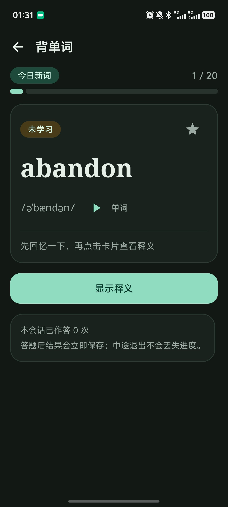

# 薄荷单词 · CetVocab

[](https://github.com/ChihoYiu/CetVocab/actions/workflows/ci.yml)


-brightgreen)

面向中国大陆大学生的 **CET-4 / CET-6 单词记忆 Android 应用**。Kotlin + Jetpack Compose + Material 3，
`minSdk 26`（Android 8.0）。**全部功能离线可用，不申请 `INTERNET` 权限**，学习数据只保存在应用私有目录，
不接入账号、广告、埋点或统计 SDK。

朗读使用**系统自带的文字转语音（TTS）服务**：语言、声音、语速与音调跟随系统设置，应用不覆盖它们，
也不需要任何权限。如果设备没有安装语音引擎或缺少英语语音包，应用会给出明确提示并提供设置入口。

> 这是一个学习辅助工具，不是官方考试系统。应用不声称与任何考试机构存在合作关系，不承诺提分、押题或通过考试。
> 内置词库来自 **ECDICT（MIT 许可）**，为完整的四级 3,849 词 / 六级 5,407 词；你也可以导入自己拥有
> 合法使用权的 JSON / CSV 词库。第三方内容的许可见 [THIRD-PARTY-NOTICES.md](THIRD-PARTY-NOTICES.md)。

**快速入口**：[使用指南](docs/USER_GUIDE.md) · [下载安装包](https://github.com/ChihoYiu/CetVocab/releases) ·
[自己构建](#如何运行) · [贡献指南](CONTRIBUTING.md) · [发布签名](docs/RELEASE_SIGNING.md) · [行为准则](CODE_OF_CONDUCT.md)

### 验证状态

CI 徽章是**真实**的：每次推送到 `main` 或提 PR 都会在 GitHub Actions 上跑全部单元测试并构建调试包
（见 [.github/workflows/ci.yml](.github/workflows/ci.yml)）。打 tag 时由
[release.yml](.github/workflows/release.yml) 构建**已签名**的正式包并在打包后校验签名。

| 项目 | 结果 |
| --- | --- |
| 单元测试 `:app:testDebugUnitTest` | **370 个用例通过，0 失败 / 0 错误**（22 个测试类）；本机与 CI（ubuntu-latest + JDK 21）结果一致 |
| 发布包 `:app:assembleRelease`（R8，已签名） | 由 CI 构建，2.39 MB，`apksigner verify` 通过 |
| `apkanalyzer` 权限核对 | 不含 `INTERNET`；`minSdk 26` / `targetSdk 36` |

---

## 界面

| 首页 | 学习 |
| --- | --- |
|  |  |

首页一屏回答四个问题：今日进度（环形 + 已学 / 正确率 / 时长）、**下一步该做什么**（带时间估算和一个按钮）、
词汇状态分布、以及下一个阶段目标。学习卡默认隐藏释义，先回忆再点击查看。

---

## 功能一览

| 模块 | 内容 |
| --- | --- |
| 首次启动 | 欢迎页 → 选择 CET-4 / CET-6 → 每日目标 → 学习提醒 → 朗读方式；每一步都可「稍后设置」；首次启动会播种完整词库并显示真实进度 |
| 首页仪表盘 | **四段式信息层级**：① 今日进度（环形 + 已学/正确率/时长，可查看统计口径）② **下一步该做什么**（「还需复习 12 个单词，约 4 分钟」+ 一个按钮）③ 词汇状态三色条（已掌握 / 学习中 / 未学习）④ 阶段目标（下一个里程碑）⑤ 最多 2 条**带依据的学习建议** ⑥ 每天一条激励 ⑦ 本周趋势 ⑧ 最近学习记录 |
| 学习分析 | 8 条规则主动分析正确率变化、只学新词不复习、题型薄弱、已掌握词回潮、学习频率下降、单次过长效率下降、薄弱词集中；**数据不足时只说明「数据有限」，不做任何判断**；每条建议都带真实数字与一个可执行动作 |
| 激励 | 7 个场景（完成学习 / 破连续纪录 / 中断后回归 / 正确率提升 / 达成里程碑 / 遇到困难 / 日常）的**原创**语句，确定性选择；首页每天最多 1 条，破纪录与里程碑各自只庆祝一次 |
| 单词记忆 | 默认隐藏释义（带过渡动画）、点击显示、**系统 TTS 朗读单词与例句**、词性 / 释义 / 例句 / 例句翻译 / 常见搭配、收藏、`12 / 50` 进度、不认识 / 模糊 / 已掌握、即时巩固队列、退出与重启后恢复、会话总结 |
| 朗读（发音） | 单词 / 例句 / 中文释义都可朗读；按钮具备**空闲 / 加载 / 播放 / 失败**四态；三种失败（引擎不可用、缺少语音包、不支持该语言）都给出提示、系统设置入口与重试；设置页可试听并查看引擎信息与本机朗读成功率 |
| 间隔重复 | 透明的 SM-2 风格规则（纯函数 + 单元测试），到期词优先、错题与未巩固词优先于新词，跨天 / 时区 / 重启 / 时钟异常均有处理 |
| 错题本与复习中心 | 今日待复习、未巩固词、高错误次数、最近错题、历史错题、收藏单词；搜索、按错误次数与收藏筛选、收藏切换、单个 / 批量重新练习、标记已巩固、删除前确认、条目动画、空 / 加载 / 错误状态 |
| 词库浏览 | 完整词表的查词入口（我的 → 浏览 / 搜索词库）：按英文前缀或中文释义搜索，220 ms 防抖，结果可进入单词详情 |
| 闭卷考试 | 独立专注模式；考试全程不显示释义、例句、搭配与正确答案；题号 / 总题数 / 已作答 / 剩余时间；提前交卷；退出可保存草稿或放弃；重复提交防护；题目在开考时生成快照；支持恢复草稿。题型：英译中、中译英、四选一、拼写填空 |
| 成绩页 | 总分、正确率、用时、各题型正确率、错题清单、薄弱题型、加入错题本结果、再次练习、返回首页 |
| 学习统计 | 累计学习单词、累计复习次数、连续学习天数、学习时长、正确率、复习完成率、周 / 月趋势、12 周学习日历、词库进度、阶段目标；无数据时展示友好空状态 |
| 个人中心与设置 | 词库切换、每日新词、每日复习上限、提醒时间、朗读速度 / 自动朗读 / 同时朗读例句、发音服务状态与试听、浅色 / 深色 / 跟随系统（含状态栏图标正确反色）、动态颜色（Android 12+）、动画开关、数据导入导出、恢复默认设置、清空学习进度、重置全部数据、隐私说明、词库来源与许可、关于 |
| 词库导入导出 | 系统文件选择器（SAF）；JSON / CSV；大小与字段校验、导入预览（新增 / 更新 / 跳过 / 错误）、事务写入失败回滚、同名单词保留学习进度；导出词库 / 学习记录 / 完整备份 |

---

## 如何运行

### 1. 环境要求

* Android Studio（含 Android SDK **API 36** 平台与 Build-Tools 36）
* JDK 17 或更高（项目以 Java 17 字节码编译；CI 用 JDK 21）
* Gradle 使用项目自带的 Wrapper（`./gradlew`），无需本机安装

> ⚠️ **Windows 用户请注意**：仓库所在路径**不能包含中文等非 ASCII 字符**（例如放在桌面的「薄荷单词 · CetVocab」这种目录）。
> Android Gradle 插件会直接报 `Your project path contains non-ASCII characters` 并终止构建。
> 请把项目放在纯英文路径下，例如 `D:\code\CetVocab`。

### 2. 配置 SDK 路径

`local.properties`（不入版本库）：

```properties
sdk.dir=/path/to/Android/Sdk
```

### 3. 常用命令

```bash
./gradlew :app:assembleDebug          # 构建调试 APK
./gradlew :app:installDebug           # 安装到已连接设备 / 模拟器
./gradlew :app:testDebugUnitTest      # 运行全部单元测试（含 Robolectric 数据库与 Compose UI 测试）
./gradlew :app:assembleRelease        # 构建经过 R8 压缩的发布包
```

调试安装包位于 `app/build/outputs/apk/debug/app-debug.apk`（`applicationId` 为 `com.cetvocab.app.debug`）。
要出自带签名的正式包，请先按 [发布签名](docs/RELEASE_SIGNING.md) 配置密钥（**密钥不要提交**）。

### 4. 验证 Android 8.0 兼容性

在 API 26 模拟器或真机上执行 `./gradlew :app:installDebug`，首次启动会创建通知渠道（Android 8.0 起为必需），
随后按首页 → 学习 → 错题本 → 考试 → 统计 → 我的的顺序操作一遍即可覆盖全部核心路径。
本仓库的自动化测试中，`DatabaseTest`、`ProgressRecorderTest` 与 `ComposeFlowTest` 均以 `@Config(sdk = [26])`
运行，即在 JVM 上以 API 26 的 `android-all` 镜像执行。

---

## 模块结构

```
app/src/main/java/com/cetvocab/app/
├── core/            通用结果类型、时间（学习日 04:00 边界）、JSON 编解码
├── domain/          纯 Kotlin 业务规则（可单元测试，无 Android 依赖）
│   ├── srs/         间隔重复算法与词汇进度模型
│   ├── study/       队列构建、会话状态机、会话统计
│   ├── exam/        题目生成、评分（英文选中文 / 中文选英文 / 四选一 / 拼写）
│   ├── importer/    JSON / CSV 解析、字段校验、重复合并规则
│   ├── mistake/     错题本分类与筛选模型
│   ├── stats/       连续天数、正确率、日历序列
│   └── model/       Word / CetLevel 等共享模型
├── data/
│   ├── local/       Room：10 张表 + 1 个视图、8 个 DAO、迁移策略
│   ├── settings/    Preferences DataStore（用户设置）
│   ├── repository/  Repository 边界：词库、学习、错题、考试、统计、备份
│   ├── io/          Storage Access Framework 文件读写
│   ├── seed/        内置演示词库（自建数据）
│   └── mapper/      Room 行 ↔ 领域模型映射
├── ui/              Compose 页面、可复用组件、主题、导航、ViewModel
└── work/            WorkManager 学习提醒（通知渠道 + 权限处理）
```

架构约定：Composable 不接触 DAO / DataStore / 文件系统；ViewModel 只依赖 Repository 接口，
暴露不可变 `StateFlow`；页面通过回调触发 ViewModel 事件；`NavController` 不传入页面。
依赖注入使用 `AppContainer`（构造器注入），未引入 Hilt —— 对象图很小，这样构建更快、接线更清晰，
`AppContainer` 还提供测试用的内存数据库注入点。

---

## 文档

**面向使用者**

* [使用指南](docs/USER_GUIDE.md) —— 安装、五分钟上手、各页面怎么用、统计口径、朗读问题排查、数据与隐私
* [词库导入格式说明](docs/WORD_PACK_FORMAT.md) —— JSON / CSV 字段定义、示例文件与版权注意事项

**面向开发者**

* [文档索引](docs/README.md) —— 全部文档的入口
* [贡献指南](CONTRIBUTING.md) —— 构建、测试、代码约定与 PR 要求
* [发布签名](docs/RELEASE_SIGNING.md) —— 生成密钥库、本机与 CI 出正式包（密钥绝不入库）
* [行为准则](CODE_OF_CONDUCT.md)
* [词库校验报告](docs/WORD_PACK_VALIDATION.md) —— 内置词库的来源、许可证、完整性实测数字与音标转写说明
* [发音验证报告（历史）](docs/PRONUNCIATION_VERIFICATION.md) —— 已移除的真人录音模块的线上实测：美/英命中率、字节与许可证
* [第三方内容与许可](THIRD-PARTY-NOTICES.md) —— 内置词库（ECDICT MIT）的版权声明与各候选数据源的采用记录
* [词库构建与校验脚本](tools/wordpack/) —— 词库是如何从上游生成、转写与校验的（可复现）
* 开发过程记录（根因分析、实测数据、方案依据）：[docs/dev/](docs/dev/)

## 许可证

代码以 MIT 许可发布。内置词库来自 [ECDICT](https://github.com/skywind3000/ECDICT)（MIT，Copyright (c) 2025 Linwei），
完整四级 3,849 词 / 六级 5,407 词；词库校验与许可证细节见 [WORD_PACK_VALIDATION.md](docs/WORD_PACK_VALIDATION.md)。
朗读由设备的系统文字转语音服务完成，应用不分发任何第三方音频。激励语句均为本项目原创，不含外部引用。
